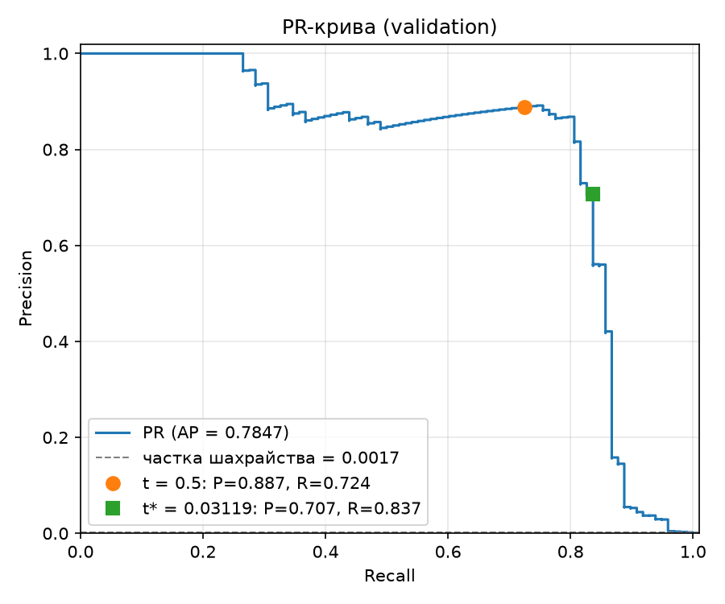
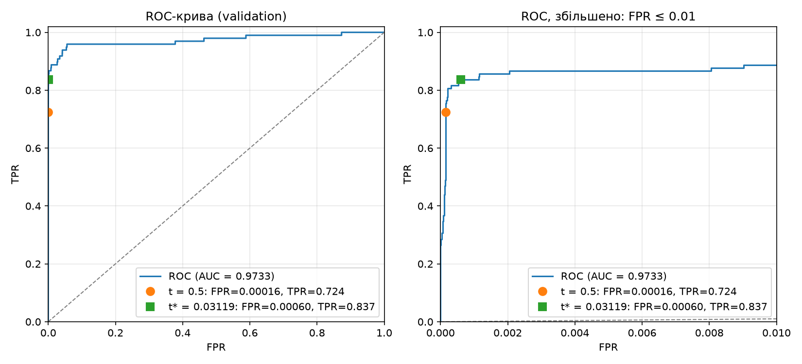

# ЛР2. Поріг рішення під асиметричну ціну помилок

Модель `Linear(29,32) → ReLU → Linear(32,1)` навчається один раз на Credit Card Fraud. Модель не змінюється, змінюється лише поріг рішення: його обрано на validation за мінімумом вартості $C(t)=10\,FN(t)+FP(t)$ і один раз застосовано до test.

## Запуск

Потрібен [`uv`](https://docs.astral.sh/uv/); Python 3.12 він завантажить сам. Дані: [Credit Card Fraud Detection (Kaggle)](https://www.kaggle.com/datasets/mlg-ulb/creditcardfraud), файл `creditcard.csv` (потрібен обліковий запис Kaggle). CSV у репозиторій не додано, шлях передається через `--data`. Команди виконуються з теки `lab2/`:

```bash
# 1. Навчання з локального CSV у нову теку (тека --out має бути порожньою або відсутньою)
uv run --locked lab2_starter.py --data /шлях/до/creditcard.csv --out results_rerun

# 2. Аналіз (пункти 2-4) зі збережених прогнозів, без CSV і без навчання -> report/
uv run --locked analysis.py --saved results --out report
```

Числа звіту отримано з закомічених прогнозів у `results/`; команда 2 відтворює їх без навчання. Стартовий код не перезаписує непорожню теку, тому повторне навчання пишеться в `results_rerun/`. Його результат можна проаналізувати так само: `uv run --locked analysis.py --saved results_rerun --out report_rerun`.

Окремо перевірки A/B/C: `uv run --locked checks.py`.

**Залежності.** Прямі залежності зафіксовано точними версіями в `pyproject.toml`. Повне дерево з хешами для всіх платформ лежить в `uv.lock`, а `--locked` гарантує, що встановиться саме воно. Перший `uv run` сам створить `.venv` з Python 3.12. Torch береться так:
- Linux і Windows: `torch==2.2.2+cpu` з індексу `download.pytorch.org/whl/cpu`, без CUDA. Індекс позначено `explicit`, тож з нього береться лише torch.
- macOS: `torch==2.2.2` з PyPI (на macOS він і так без CUDA).

**Чому torch 2.2.2 і numpy 1.26.4.** Torch 2.2.2 — остання версія PyTorch, для якої є готові колеса під усі поширені платформи, зокрема Mac з процесором Intel: новіші версії Intel Mac не підтримують. Torch 2.2 скомпільовано під NumPy 1.x, тому numpy зафіксовано на 1.26.4, а pandas, scikit-learn і matplotlib — на версіях, що мають колеса для всіх цих платформ і сумісні з NumPy 1.26.

| Платформа | Мінімальна версія ОС |
|---|---|
| Windows x64 | Windows 10 |
| Linux x86_64 / aarch64 | glibc ≥ 2.17 (manylinux2014) |
| macOS Apple Silicon (arm64) | macOS 12 |
| macOS Intel (x86_64) | macOS 10.14 |

Для всіх п'яти платформ `uv.lock` містить лише готові колеса, тож нічого не компілюється з вихідного коду. Перевірено встановленням з lock-файлу з `--only-binary :all:` під кожну платформу, а на Windows x64 — повним запуском обох команд.

| Файл | Зміст |
|---|---|
| `pyproject.toml`, `uv.lock` | зафіксовані залежності (див. вище) |
| `lab2_starter.py` | стартовий код викладача: поділ, стандартизація, навчання, збереження |
| `threshold.py` | TP/FP/FN/TN, $C$, швидкий пошук порога, precision/recall |
| `checks.py` | незалежний повільний перебір і перевірка на наборах A/B/C |
| `analysis.py` | пункти 2-4: криві, таблиця кандидатів, $t^*$, test, розбір помилок |
| `results/` | `model.pt` (ваги), `predictions.npz` (індекси рядків CSV, мітки, Amount, оцінки val/test), `preprocessing.npz` (mean/scale scaler), `run.json` |
| `report/` | криві, `validation_candidates.csv`, `threshold.json`, `check_*.csv`, `test_*.csv/json` |

## 1. Дані, поділ і навчання

Ознаки: V1-V28 і Amount (29 штук), `Time` і `Class` на вхід моделі не подаються. Сирий Amount збережено окремо для аналізу помилок. Поділ індексів: `train_test_split(test_size=0.4, stratify=Class, random_state=0)`, потім відкладену частину ділимо навпіл (`test_size=0.5`, стратифікація, `random_state=0`): перша половина — validation, друга — test. Номери рядків CSV (від 0, без заголовка) збережено для кожної вибірки.

| Вибірка | Об'єктів | Шахрайських | Частка |
|---|---:|---:|---:|
| train | 170 884 | 295 | 0.1726 % |
| validation | 56 961 | 98 | 0.1720 % |
| test | 56 962 | 99 | 0.1738 % |
| разом | 284 807 | 492 | 0.1727 % |

`StandardScaler` навчено лише на train: $x'_j=(x_j-\mu_j)/\sigma_j$, де $\mu_j,\sigma_j$ обчислено за 170 884 рядками train. Ці самі статистики застосовано до validation і test. Масиви для моделі мають тип float32, класи не балансувалися.

**Чому не можна рахувати статистики на всьому наборі.** Validation і test імітують нові дані, яких модель не бачила. Якщо $\mu$ і $\sigma$ обчислено з урахуванням цих рядків, у перетворення train просочується інформація про validation і test (data leakage). Особливо це стосується Amount, розподіл якого має важкий хвіст: кілька великих сум у test змістили б $\mu$ і $\sigma$ для всіх. Оцінка якості тоді вже не є чесною перевіркою на невідомих даних. Крім того, поріг $t^*$ обирається на validation, тому validation теж не має впливати на підготовку ознак. На практиці нові транзакції масштабуються статистиками, відомими на момент навчання.

Навчання: BCEWithLogitsLoss без зважування класів, Adam з lr $=10^{-3}$, 12 епох, пакет 1024 (останній неповний пакет не відкидається), `torch.manual_seed(0)`, перемішування через окремий `np.random.default_rng(0)`. Використано ваги після 12-ї епохи. BCE на train зменшилась з 0.3653 (1-ша епоха) до 0.003383 (12-та). Оцінки $s_i=\mathrm{sigmoid}(z_i)$ для validation і test отримано в `eval()` під `no_grad` і збережено без округлення.

## 2. Вибір порога на validation

### Метрики та вартість

Прогноз «шахрайство», якщо $s_i\ge t$. Для порога $t$:

$$TP=\#\{s_i\ge t,\ y_i=1\},\quad FP=\#\{s_i\ge t,\ y_i=0\},\quad FN=\#\{s_i<t,\ y_i=1\},\quad TN=\#\{s_i<t,\ y_i=0\},$$

$$C(t)=10\,FN(t)+FP(t),\qquad \text{precision}=\frac{TP}{TP+FP},\qquad \text{recall}=\frac{TP}{TP+FN}.$$

$FN$ (пропущене шахрайство) коштує в 10 разів більше за $FP$ (хибну тривогу). Amount у вартість не входить.

### Криві

| PR-крива | ROC-крива |
|---|---|
|  |  |

**ROC-AUC = 0.9733** (average precision = 0.7847).

**Чому висока ROC-AUC не гарантує малої вартості чи високої precision.**
- ROC-AUC — це ймовірність того, що випадкове шахрайство отримає вищу оцінку, ніж випадкова легітимна транзакція. Вона усереднює якість ранжування за всіма порогами і нічого не каже про конкретний поріг. Для тієї самої моделі з тією самою AUC поріг 0.5 дає $C=279$, $t^*$ дає $C=194$, а «всі негативні» — $C=980$.
- ROC використовує FPR $=FP/(FP+TN)$, а негативних у 580 разів більше, ніж позитивних. При $t^*$ FPR дорівнює лише 0.0006, але це 34 хибні тривоги на 82 знайдених шахрайства, тобто precision 0.707. Малий FPR при сильному дисбалансі все одно означає багато FP відносно TP. PR-крива це показує, а ROC-крива — ні.
- AUC не враховує асиметричні ціни помилок: 10:1 впливає лише на вибір точки на кривій.

### Пошук порога за $O(n\log n)$

Реалізація: `candidate_table` у [threshold.py](threshold.py).

1. Кандидати — це $+\infty$ і всі унікальні оцінки validation. Поріг $+\infty$ означає «усі негативні», найменша оцінка — «усі позитивні».
2. Оцінки сортуються за спаданням (`argsort(-s, kind="stable")`, $O(n\log n)$), і рахуються кумулятивні суми $\mathrm{cumTP}_k=\sum_{i\le k}y_{(i)}$ та $\mathrm{cumFP}_k=\sum_{i\le k}(1-y_{(i)})$.
3. **Рівні оцінки.** Для порога $t=s_{(k)}$ правило $s\ge t$ відносить до позитивних **усю** групу рівних оцінок. Тому лічильники беруться лише на **останньому** індексі кожної групи рівних значень, тобто там, де $s_{(k)}\ne s_{(k+1)}$. Усередині групи сума не зупиняється, і рівні оцінки завжди отримують однаковий прогноз.
4. $TP=\mathrm{cumTP}$ на межі групи, $FP=\mathrm{cumFP}$, $FN=P-TP$, $TN=N-FP$; для $+\infty$ $TP=FP=0$. Кожен кандидат обробляється за $O(1)$, без повторного проходу по вибірці.
5. **Вибір.** Беремо мінімальну $C$. Якщо мінімум досягається на кількох порогах, береться **найбільший** поріг (`select_threshold`): він дає менше спрацювань за тієї ж вартості.

На validation 56 961 оцінка має 55 967 унікальних значень, тож разом із $+\infty$ маємо 55 968 кандидатів. Рівні оцінки на реальних даних не рідкість: 1 730 оцінок validation утворюють 736 груп рівних значень (найбільша група — 16 оцінок). 1 170 із них належать транзакціям з однаковими 29 ознаками: у CSV є 9 144 зайві копії рядків за V1–V28 і Amount, переважно рядки, що відрізняються лише полем `Time`. Решта — збіги значень оцінок у float32. Отже, обробка рівних оцінок потрібна на реальних даних, а не лише в тестах. Повна таблиця: [report/validation_candidates.csv](report/validation_candidates.csv). Поріг збережено без округлення в [report/threshold.json](report/threshold.json).

$$t^*=0.031193982809782028\quad(\text{float32, hex } \texttt{0x1.ff150cp-6})$$

| Правило на validation | Поріг | TP | FP | FN | TN | C |
|---|---:|---:|---:|---:|---:|---:|
| Стандартний поріг | 0.5 | 71 | 9 | 27 | 56 854 | 279 |
| Мінімум вартості | $t^*\approx 0.031194$ | 82 | 34 | 16 | 56 829 | **194** |
| Усі негативні | $+\infty$ | 0 | 0 | 98 | 56 863 | 980 |

Мінімум єдиний, нічиєї на validation немає. Він лежить точно на сходинці: наступний більший кандидат (0.031203) втрачає одне шахрайство і дає $C=204$. Сусідні менші пороги додають по одному FP ($C=195, 196,\dots$). Усі кандидати з $C\le 200$ лежать у вузькому діапазоні $t\in[0.0293;\,0.0454]$.

## 3. Перевірка реалізації пошуку порога

[checks.py](checks.py) містить незалежний повільний перебір на чистому Python. Він не використовує жодної функції з `threshold.py`: власний список кандидатів, пряме застосування $s_i\ge t$ до кожного прикладу для кожного кандидата, власна вартість і власне правило нічиєї. Таблиця перебору порівнюється зі швидкою таблицею поелементно на точну рівність (поріг, TP, FP, FN, TN, C), а також порівнюється вибраний поріг. `analysis.py` запускає ці перевірки першими і зупиняється без тестової оцінки, якщо хоча б одна не пройдена. Усі три **пройдено**, таблиці: `report/check_{A,B,C}.csv`.

**Набір A:** $s=[0.9,0.7,0.7,0.4,0.2,0.1]$, $y=[0,1,0,1,0,0]$.

| Поріг | TP | FP | FN | TN | C |
|---:|---:|---:|---:|---:|---:|
| $+\infty$ | 0 | 0 | 2 | 4 | 20 |
| 0.9 | 0 | 1 | 2 | 3 | 21 |
| 0.7 | 1 | 2 | 1 | 2 | 12 |
| **0.4** | 2 | 2 | 0 | 2 | **2** |
| 0.2 | 2 | 3 | 0 | 1 | 3 |
| 0.1 | 2 | 4 | 0 | 0 | 4 |

$t^*=0.4$. **Що перевіряється:** дві оцінки 0.7 мають різні мітки (1 і 0). Кандидатів 6, а не 7, і при $t=0.7$ обидва приклади позитивні одночасно (TP=1, FP=2). Хибна реалізація, яка рахує межу після кожного елемента, дала б зайвий рядок з TP=1, FP=1 або TP=0, FP=2 залежно від порядку сортування.

**Набір B:** $s=[0.9,0.6,0.3]$, $y=[0,0,0]$.

| Поріг | TP | FP | FN | TN | C |
|---:|---:|---:|---:|---:|---:|
| $+\infty$ | 0 | 0 | 0 | 3 | **0** |
| 0.9 | 0 | 1 | 0 | 2 | 1 |
| 0.6 | 0 | 2 | 0 | 1 | 2 |
| 0.3 | 0 | 3 | 0 | 0 | 3 |

$t^*=+\infty$. **Що перевіряється:** граничний випадок без позитивних міток. Кандидат $+\infty$ має бути в списку, бо лише він дає $C=0$. Кумулятивні суми TP мають залишатися нулем, а $FN=P-TP$ має коректно дорівнювати 0. Recall тут не визначений для жодного порога ($TP+FN=0$), а precision при $+\infty$ не визначена ($TP+FP=0$).

**Набір C:** $s=[0.8,\underbrace{0.5,\dots,0.5}_{11},0.2]$, $y=[1,1,\underbrace{0,\dots,0}_{10},0]$.

| Поріг | TP | FP | FN | TN | C |
|---:|---:|---:|---:|---:|---:|
| $+\infty$ | 0 | 0 | 2 | 11 | 20 |
| **0.8** | 1 | 0 | 1 | 11 | **10** |
| 0.5 | 2 | 10 | 0 | 1 | **10** |
| 0.2 | 2 | 11 | 0 | 0 | 11 |

$t^*=0.8$. **Що перевіряється:**
- Пороги 0.8 і 0.5 мають однакову мінімальну вартість $C=10$, тож перевіряється правило нічиєї: вибрано **більший** поріг 0.8. Мінімум, знайдений через `argmin` по зростанню порогів, дав би 0.5.
- Велика група з 11 рівних оцінок 0.5 зі змішаними мітками. Якби група розривалася після першої 0.5 (мітка 1), виник би неіснуючий кандидат з TP=2, FP=0, $C=0$, і пошук «знайшов» би неможливу нульову вартість.

## 4. Тестова оцінка та аналіз помилок

$t^*$ зафіксовано на validation і один раз застосовано до test. Test не використовувався для вибору порога, моделі чи налаштувань.

| Test, $t^*\approx 0.031194$ | Прогноз: шахрайство | Прогноз: легітимна |
|---|---:|---:|
| **Факт: шахрайство** | TP = 80 | FN = 19 |
| **Факт: легітимна** | FP = 43 | TN = 56 820 |

$$C=10\cdot 19+43=\mathbf{233},\qquad \text{precision}=\frac{80}{123}=0.6504,\qquad \text{recall}=\frac{80}{99}=0.8081.$$

Для порівняння (лише для висновків, не для вибору порога):

| Правило на test | Поріг | TP | FP | FN | TN | C | Precision | Recall |
|---|---:|---:|---:|---:|---:|---:|---:|---:|
| Стандартний поріг | 0.5 | 71 | 8 | 28 | 56 855 | 288 | 0.8987 | 0.7172 |
| Мінімум вартості | $t^*$ | 80 | 43 | 19 | 56 820 | **233** | 0.6504 | 0.8081 |
| Усі негативні | $+\infty$ | 0 | 0 | 99 | 56 863 | 990 | не визначена | 0 |

**Невизначені метрики.** Для «усіх негативних» $TP+FP=0$: модель не зробила жодного позитивного прогнозу, тому частка правильних серед них — це $0/0$, і precision не визначена. Не можна підставити 0 чи 1 без довільної домовленості. Recall при цьому визначений і дорівнює 0, бо в test є 99 шахрайств. Recall був би невизначеним, якби у вибірці не було позитивних ($TP+FN=0$), як у наборі B. Для $t^*$ на test обидва знаменники ненульові.

### Перші п'ять FP і п'ять FN на test (за номером рядка CSV)

| Рядок CSV (від 0, без заголовка) | Тип помилки | Мітка | Оцінка $s$ | Amount | $\lvert s-t^*\rvert$ |
|---:|:---:|:---:|---:|---:|---:|
| 460 | FP | 0 | 0.196159 | 2.00 | 0.164965 |
| 2961 | FP | 0 | 0.080961 | 2.49 | 0.049767 |
| 10783 | FP | 0 | 0.966327 | 89.99 | 0.935133 |
| 13405 | FP | 0 | 0.932032 | 89.99 | 0.900838 |
| 13617 | FP | 0 | 0.922762 | 89.99 | 0.891568 |
| 10497 | FN | 1 | 0.011464 | 3.79 | 0.019730 |
| 52521 | FN | 1 | 0.006373 | 105.99 | 0.024821 |
| 55401 | FN | 1 | 0.005642 | 1.00 | 0.025552 |
| 91671 | FN | 1 | 0.000500 | 290.18 | 0.030694 |
| 93486 | FN | 1 | 0.018352 | 0.00 | 0.012842 |

Повна таблиця: [report/test_errors.csv](report/test_errors.csv). Статистики за всіма помилками test: [report/test_error_stats.csv](report/test_error_stats.csv).

| Група на test | n | Медіана Amount | Середнє Amount | Медіана $\lvert s-t^*\rvert$ |
|---|---:|---:|---:|---:|
| FP | 43 | 2.49 | 110.98 | 0.0250 |
| FN | 19 | 33.76 | 161.99 | 0.0291 |
| TP | 80 | 8.26 | 121.99 | 0.8169 |
| TN | 56 820 | 22.03 | 88.93 | 0.0309 |

**Порівняння FP і FN.**
- **Відстань до порога.** Усі FN мають оцінки нижче 0.0215, тобто модель упевнено вважає ці транзакції легітимними. Але сам $t^*$ малий, тому в абсолютних числах вони лежать «близько» до порога (до 0.031). Через те що $t^*\approx 0.03$, будь-яка оцінка нижче порога відстоїть від нього не більше ніж на 0.031, тож мала $\lvert s-t^*\rvert$ для FN не означає, що модель сумнівалась. FP поділяються на дві групи: близькі до порога ($s\approx 0.03$–$0.08$, медіана для всіх FP 0.056) та впевнені ($s>0.9$). Три з п'яти перших FP мають $s>0.92$ і однаковий Amount = 89.99. Схоже, це однотипні транзакції, які модель вважає шахрайством з високою впевненістю; можливо, вони схожі на справжнє шахрайство, а можливо, мітки неточні.
- **Amount.** Серед перших десяти прикладів суми трапляються від 0 до 290. FP мають малу медіану (2.49), FN — більшу (33.76), але середні сильно залежать від кількох великих сум. Значення в обох групах перекриваються з розподілом TN і TP, тобто Amount сам по собі помилок не пояснює.

**Чи можна за десятьма прикладами судити про причину помилок?** Ні. Це перші за номером рядка приклади, а не випадкова чи репрезентативна вибірка, і їх лише 10 із 62 помилок. Модель використовує 29 ознак, з яких 28 — анонімізовані компоненти PCA (V1–V28), і Amount — лише одна з них. Десять прикладів годяться, щоб сформулювати гіпотези (наприклад, повторюваний Amount 89.99 серед упевнених FP), але не щоб їх підтвердити. Для висновків потрібні всі помилки, порівняння розподілів ознак з TP і TN та перевірка гіпотез на окремих даних.

## Висновки

**Що змінив вибір порога.** Ваги моделі однакові для всіх рядків таблиць. Змінилося лише місце, де ранжування оцінок розрізається на «шахрайство» і «легітимна». Перехід від 0.5 до $t^*\approx 0.031$ свідомо обмінює хибні тривоги на знайдені шахрайства, бо пропуск у 10 разів дорожчий:

| | ΔFN | ΔFP | ΔC |
|---|---:|---:|---:|
| validation (0.5 → $t^*$) | 27 → 16 (−11) | 9 → 34 (+25) | 279 → 194 (−85, −30 %) |
| test (0.5 → $t^*$) | 28 → 19 (−9) | 8 → 43 (+35) | 288 → 233 (−55, −19 %) |

**Ціна рішення.**
- На test 9 додатково знайдених шахрайств коштували 35 додаткових хибних тривог, приблизно 3.9 FP на кожне знайдене. Це вигідно, поки один FN коштує більше за ~3.9 FP; при ціні 10 так і є.
- Precision на test упала з 0.899 до 0.650: кожна третя тривога тепер хибна. Recall зріс з 0.717 до 0.808.
- 19 шахрайств із 99 модель усе одно пропускає: їхні оцінки нижчі за поріг, і лише зміною порога їх не повернути без різкого зростання FP.

**Чому результат на validation не гарантує такого виграшу на test.**
1. $t^*$ — це мінімум, знайдений на тих самих даних, на яких його оцінено, тому $C=194$ на validation оптимістично зміщена. На validation виграш становив 85, на test — 55.
2. Позитивних мало (98 у validation, 99 у test), тож кожне шахрайство змінює $C$ на 10. Мінімум лежить точно на сходинці: зсув порога на $10^{-5}$ вгору втрачає одне шахрайство (+10). Випадкова різниця в кілька прикладів між вибірками помітно змінює $C$.
3. Поріг $0.031$ лежить у щільній зоні оцінок легітимних транзакцій. Там невеликий зсув розподілу оцінок між вибірками змінює FP на десятки: 34 на validation проти 43 на test.

Тобто $t^*$ — це оцінка оптимального порога з дисперсією, а не гарантоване значення. Чесна оцінка його якості — тест, а не validation.

## Відтворюваність

`analysis.py` працює лише з `results/predictions.npz` і детерміновано відтворює всі числа цього звіту: $t^*$, лічильники, $C$, таблицю помилок. Повторне навчання на тій самій машині дало ідентичні поділ, статистики scaler, ваги й оцінки, і повторний аналіз збігся з `report/` побайтово (крім PNG). На іншій платформі чи з іншою версією PyTorch оцінки можуть відрізнятися в молодших розрядах. Для перевірки модель навчено і з torch 2.14.1 / numpy 2.5.4. Поділ, мітки й статистики scaler збіглися побітово, оцінки відрізнялися не більш ніж на $1.8\cdot10^{-6}$. Усі лічильники, $C$, precision і recall на validation і test виявилися тими самими, а $t^*$ змінився лише у 8-му знаку (0.0311938971 проти 0.0311939828). Висновки звіту від версії бібліотек не залежать. Середовище навчання (версії бібліотек, кількість потоків): [results/run.json](results/run.json).

## Джерела та інструменти

- Стартовий код (`lab2_starter.py`) надано викладачем; змінено лише вивід консолі в UTF-8 для Windows.
- Код `threshold.py`, `checks.py`, `analysis.py` і чернетку цього README підготовлено з допомогою генеративного асистента Claude (Anthropic, Claude Code). Формули, алгоритм пошуку, результати перевірок і числа звіту перевірено вручну і повторними запусками.
- Набір даних: Machine Learning Group, ULB, «Credit Card Fraud Detection», Kaggle.
